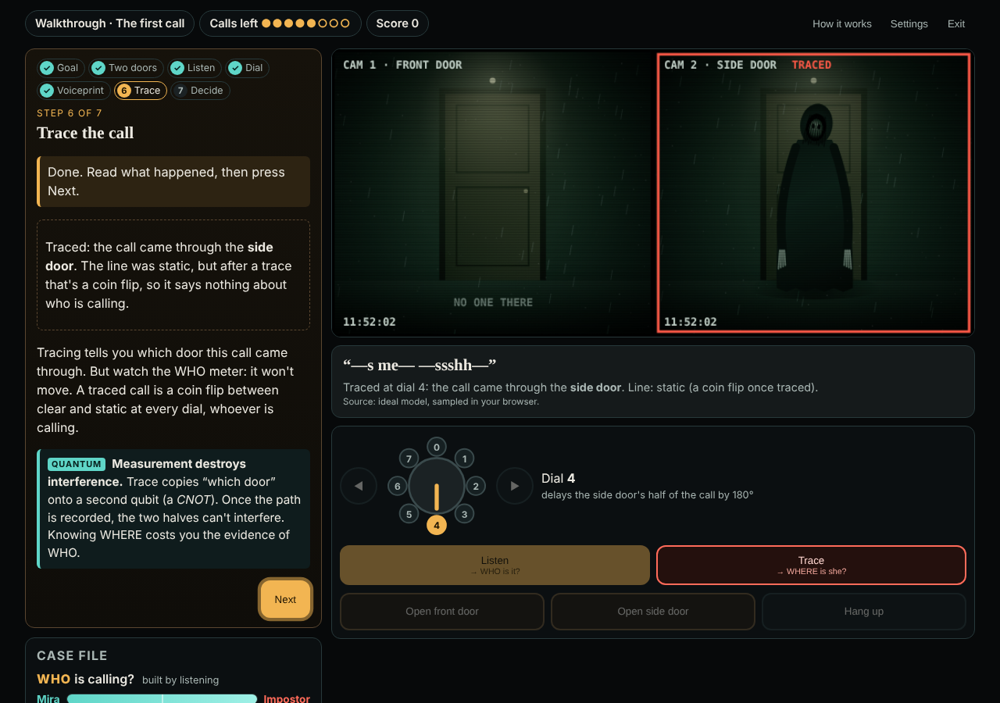

# The Last Call

**A quantum horror game in AR. One call, two doors.**

This effort is supported by Qollab & IonQ

Late at night your sister Mira calls and asks you to let her in. The intercom shows her at the
front door **and** the side door at the same time: one call, two entrances. Something that sounds
exactly like her has been calling too.

* **Listen** recombines the two door channels at the handset. Whether they add up (a clear line)
  or cancel (static) depends on a dial you control and on the caller's hidden phase. Mira and
  the thing that isn't Mira produce different interference patterns, so listening tells you
  **who** is calling.
* **Trace** records which door the call came through. You learn **where** she is, but the
  which-door record destroys the interference: a traced call is a coin flip at every dial
  setting, for Mira and the mimic alike.

You need both answers: who it is (open, or hang up?) and where she is (which door?). Every
listen and every trace spends one of a handful of calls. **Finding where the caller is destroys
the evidence of who they are.**



## Play

| Where | How |
|---|---|
| Android phone, AR on your table | Chrome on an ARCore phone, HTTPS address of the deployed app → *Play in AR on your table*, move over a table until the ring appears, tap to place the house |
| iPhone, AR with no marker | *Play in AR, no marker*: allow camera and Motion & Orientation; hold the phone up and the house appears ahead of you. Turning and tilting keep it fixed in the room (rotation tracking only; walking around it needs the marker) |
| iPhone (and others), AR on a printed marker | print `marker.html` at 100% (120 mm square), lay it on a table → *Play in AR on a printed marker*: full table tracking, walk around the house |
| Any screen | *Play on this screen* (keyboard: ← → dial, L listen, T trace) |
| **Qollab** | upload the contents of `qollab/`, choose a backend in *Select QPU*, press **Run**: one batched job measures every circuit the game can need, then you play on those shots |

**New players get a 7-step walkthrough** (call 1), shown in the Guide on the left: How to win →
Two doors (superposition) → Listen → Turn the dial (interference) → The voiceprint → Trace
(measurement destroys interference) → Decide. Each step locks the controls except the one to use,
then explains the result in plain words and in quantum terms. After that, the Guide shows a
goal checklist (WHO? WHERE? DECIDE) and explains every call you make; the Case file shows the
two answers building up.

Four calls make one night: the walkthrough, then three calls where the caller is Mira or the mimic
(50/50, fixed before the first call), with the mimic's phase offset shrinking from 180° to 45°
and the call leaning toward one door on the last two.

## The physics in one paragraph

The call is one qubit; its basis states are the two doors. Each call is a fresh preparation
`Ry(α) · P(θ)` (α: how the call leans between doors; θ: the caller's hidden phase, 0 for Mira).
Listening applies your dial `P(−φ)` and a Hadamard, then measures: P(clear) = ½(1 + sin α cos(θ − φ)).
Tracing adds a CNOT that copies the door onto a second qubit before the Hadamard; then
P(clear) = ½ at every dial and P(front) = cos²(α/2). See [docs/PHYSICS.md](docs/PHYSICS.md).

The interesting part is strategy, not the circuit size: the most telling dial is *not* Mira's own
setting once the mimic is only 45° off, and calls spent on traces are calls not spent on
listening. On the last call, listening at Mira's dial wins 64% of the time; listening at the
most informative dial wins 78% ([artifacts/strategy_ideal.md](artifacts/strategy_ideal.md)).

## Look and sound

Night-vision door cameras with rain, flicker and lightning; an original creature (a hooded figure
in Mira's raincoat that creeps closer as your calls run out, and a cracked, too-wide-mouthed face
if you let the wrong caller in), drawn procedurally in code. Voices are neural text-to-speech
(Piper with a LibriTTS-trained voice, CC BY 4.0), pre-rendered and processed into a phone line,
broken static and, for the mimic, a slowed, doubled, echoing voice. Captions always carry
everything; Gentle mode removes loud stingers and the jump scare's intensity.

## Where the outcomes come from (honesty)

| Mode | Source of each in-game outcome |
|---|---|
| Web app, *Ideal model* | exact probabilities from the circuit, sampled in the browser. Not a quantum computer. |
| Web app, *Illustrative noise* | same, with our own depolarizing channel (`shared/nights.json`). Not IonQ. |
| Qollab page | shots measured on the backend selected on Qollab, one shot per call, each used once. If a backend returns probabilities instead of shots, the page samples from them and says so. |

The doors, figures and voices are fiction; the circuit never processes audio. Each outcome only
selects which prepared line is shown and spoken. A classical computer can simulate these small
circuits; the point is the rule they teach.

**Status:** the three AR modes have **not yet been tested on a physical phone**, and the Qollab project
has **not yet been run on Qollab** (it was tested with a mocked bridge). See
[docs/VALIDATION.md](docs/VALIDATION.md) and [docs/AR_DEVICE_TESTS.md](docs/AR_DEVICE_TESTS.md).

## Build and test

Requirements: Node ≥ 20 with `tsc` on PATH (`npm i -g typescript`), Python 3 with NumPy. No npm
packages.

| Task | Command |
|---|---|
| Build the web app → `build/web` | `npm run build` |
| Unit tests (game rules, TS model vs Python reference, marker maths; Python model) | `npm test` |
| Local server (desktop only) | `npm run serve` → http://localhost:8080 |
| Browser tests (Playwright + Chromium) | `node tests/browser/smoke.mjs`, `marker_e2e.mjs`, `gyro_e2e.mjs`, `qollab_mock.mjs [broken]` |
| Regenerate the voices (needs Piper + the LibriTTS voice) | `PIPER=… PIPER_MODEL=… python3 scripts/make_voices.py` |
| Rebuild + check the Qollab upload | `npm run package:qollab` (`--check` to verify only) |
| Regenerate the reference table | `npm run reference` |
| Strategy benchmark | `npm run strategy` (`-- --noisy`) |
| Run the circuits with Qiskit | `python3 quantum/qiskit_run.py --out data/qiskit/ideal.json` |

**Deploy (HTTPS, needed for phone AR):** push to a public GitHub repo and enable
*Settings → Pages → Source: GitHub Actions*; `.github/workflows/pages.yml` publishes `build/web`.
Then set `AR_APP_URL` in `qollab/main.js` and run `npm run package:qollab`.

## Repository

```
shared/nights.json   the four calls, budgets, mimic offsets, illustrative noise (single source of truth)
quantum/             canonical circuits, decoding, NumPy reference model, Qiskit runner
packages/core/       pure game rules, exact simulator, evidence meter, outcome providers
apps/web/            web app: Guide/walkthrough, intercom UI, audio + voice clips, art, WebXR / marker / look-around AR
qollab/              the uploadable Qollab project (built by scripts/package_qollab.py)
tests/               unit, Python and browser tests
docs/                physics, design, validation, device tests, page copy, demo script, checklist
```

Origin, reuse and AI assistance: [ATTRIBUTION.md](ATTRIBUTION.md). Licence: MIT.
